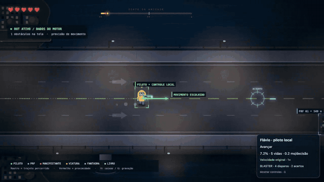
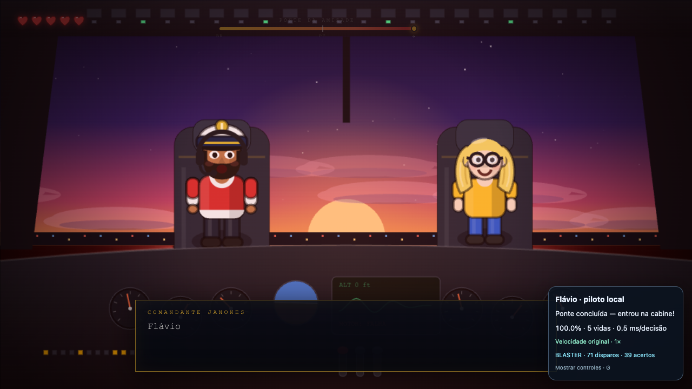

# Flávio Autoplayer 🎮

Um bot que atravessa a ponte de **[Cadê o Flávio?](https://cadeflavio.run/)** — com previsão de colisões, caixas sobre os obstáculos e um blaster que realmente remove os alvos atingidos.

Começou com “será que dá para passar da primeira fase?” e virou um laboratório de **engenharia reversa, automação e mods de jogos no navegador**. Construído por [@marlloncps](https://github.com/marlloncps), com assistência do Codex.

[](https://github.com/marlloncps/flavio-autoplayer/actions/workflows/ci.yml)
[](LICENSE)



**[Jogar o original ↗](https://cadeflavio.run/) · [Baixar a extensão e o vídeo ↓](https://github.com/marlloncps/flavio-autoplayer/releases/latest) · [Guia completo](docs/usage.md)**

## O que tem aqui

- 🧠 **Piloto automático:** prevê possíveis colisões e escolhe pequenos movimentos pelo teclado.
- 📦 **Visualização:** caixas por tipo de obstáculo, distâncias, regiões de colisão, rastro e direção escolhida.
- 🔫 **Blaster local:** mira automática, projéteis, recuo, impactos e contadores de tiros/acertos.
- ⚡ **Velocidade ajustável:** 1×, 2×, 3× e 20×, com indicação no painel.
- 🎬 **Modo de gravação:** recolhe os controles e deixa a partida em destaque.
- 🛑 **Interrupção:** F8, Escape, entrada manual, perda de foco ou troca de aba.
- 📊 **Registros em JSON:** decisões, velocidade, disparos e impactos para investigar depois.

## Qual é o jogo?

O alvo deste experimento é **[Cadê o Flávio?](https://cadeflavio.run/)**, um jogo de navegador em que o personagem precisa atravessar uma ponte desviando de obstáculos. O bot encerra sua tentativa quando entra na cabine, ao final da travessia. O diálogo narrativo posterior continua pertencendo ao jogo.

Este é um **projeto independente**. O jogo, seus personagens e recursos visuais pertencem aos respectivos criadores. Este repositório distribui o bot e os mods; o jogo continua rodando no site original. As imagens e o vídeo demonstram a execução do experimento sobre esse jogo.

## Rodar em poucos passos

Não precisa de Node.js nem de uma chave de IA para usar a extensão.

1. Baixe o ZIP da extensão na [última versão](https://github.com/marlloncps/flavio-autoplayer/releases/latest) e extraia. Se baixou o repositório inteiro, use a pasta `extension/`.
2. Abra `brave://extensions` e ative **Modo do desenvolvedor**.
3. Clique em **Carregar sem compactação** e selecione a pasta que contém `manifest.json`.
4. Abra **[o jogo com debug habilitado](https://cadeflavio.run/?debug)**.
5. Clique no ícone da extensão **Flávio — piloto local** e depois em **Iniciar tentativa**.
6. Mantenha a aba e a janela em foco para acompanhar a partida.

Se o primeiro clique no ícone mostrar `+1`, aguarde a recarga e clique novamente. Para atualizar uma instalação existente, recarregue o cartão da extensão e a página do jogo. Se mudou a pasta da extensão, carregue-a pelo novo local.

### Controles

| Controle                | Ação                                                      |
| ----------------------- | --------------------------------------------------------- |
| **Iniciar tentativa**   | O bot passa a mover o personagem e atirar automaticamente |
| **J**                   | Segure para atirar manualmente, com mira automática       |
| **Arma / Auto**         | Ativa ou desativa a arma e o disparo automático           |
| **1× / 2× / 3× / 20×**  | Ajusta a velocidade do personagem                         |
| **V**                   | Mostra ou esconde as caixas; o blaster continua visível   |
| **G**                   | Recolhe ou expande os controles para gravar               |
| **F8 / Escape / Parar** | Interrompe o bot e cancela os projéteis em voo            |
| **Setas / WASD**        | Interrompe o bot e devolve o movimento a você             |

Parar o bot mantém a velocidade selecionada. Use **1× original** para restaurá-la. Desligar a arma não restaura alvos já atingidos; reinicie/recarregue a partida para isso. O jogo continua rodando depois da interrupção.

## Como funciona

```text
Estado do jogo → cópia dos dados → previsão de movimentos → decisão → teclas
       │
       ├─→ caixas, distâncias e rastro
       └─→ mira → projétil → colisão → remoção do alvo atingido
```

O jogo oferece `window.__game` quando aberto com `?debug`. O bot lê essa interface para observar o mundo, inclusive objetos fora da tela. A cada aproximadamente 50 ms, o controlador avalia sequências curtas de movimentos e escolhe a próxima ação.

**É um controlador preditivo programado.** Esta versão não usa machine learning, Jev ou visão computacional. As caixas vêm dos dados internos; não são detecções por imagem. A previsão trabalha sobre cópias, e o movimento usa eventos de teclado.

Os mods pedidos depois têm efeitos explícitos no jogo local: o controle de velocidade altera `player.speed`, e os impactos do blaster removem somente o primeiro alvo atingido de um dos arrays vivos de inimigos, viaturas, fantasmas ou Constituição. O bot não escreve em vidas, posição ou cancela e não chama o atalho de vitória do jogo.

## Resultado registrado

| Execução                      | Resultado                                                                          |
| ----------------------------- | ---------------------------------------------------------------------------------- |
| Blaster ativo, velocidade 1×  | Cabine com **5 vidas**, **71 disparos** e **39 acertos**                           |
| Blaster ativo, velocidade 20× | Cabine com **4 vidas**, **7 disparos** e **7 acertos**                             |
| Verificação local             | **36 testes** aprovados, cobrindo previsão, controles, extensão, velocidade e arma |



São resultados de partidas observadas no Brave, em dificuldade normal, em **28/10/2026**. As duas partidas da tabela usam o mod de arma; a segunda também modifica a velocidade. Não representam uma taxa de vitória garantida. O tempo entre quadros e mudanças no site podem alterar o comportamento.

Os dados estão em [weapon-validation.json](reports/weapon-validation.json). O histórico dos experimentos e os limites da validação estão em [validation-notes.md](docs/validation-notes.md). O [vídeo completo em MP4](https://github.com/marlloncps/flavio-autoplayer/releases/latest) tem aproximadamente 28 segundos, sem áudio.

## Explorar o código

| Arquivo                                    | Responsabilidade                               |
| ------------------------------------------ | ---------------------------------------------- |
| [`src/planner.js`](src/planner.js)         | Simulação e escolha dos movimentos             |
| [`src/controller.js`](src/controller.js)   | Leitura do jogo, teclado, painel e interrupção |
| [`src/overlay.js`](src/overlay.js)         | Caixas, câmera, rastro e indicadores           |
| [`src/speed.js`](src/speed.js)             | Ajuste e restauração da velocidade             |
| [`src/weapon.js`](src/weapon.js)           | Mira, projéteis, colisões e impactos           |
| [`src/weapon-view.js`](src/weapon-view.js) | Desenho da arma, tiros e efeitos               |
| [`extension/`](extension)                  | Pacote pronto para carregar no navegador       |
| [`scripts/`](scripts)                      | Build e verificações em navegador real         |
| [`test/`](test)                            | Testes automatizados                           |

Quer investigar os tiros? Comece por [`src/weapon.js`](src/weapon.js). Para entender as decisões, comece por [`src/planner.js`](src/planner.js). O arquivo `extension/bot.js` é gerado pelo build; faça alterações em `src/`.

## Desenvolvimento

Use **Node.js 20+**. As dependências são necessárias para desenvolver e testar; a extensão pronta não depende delas no navegador.

```sh
npm ci
npm test
npm run build
npm run format:check
```

Depois de editar `src/`, gere o bundle, recarregue a extensão e a página. `npm run format` padroniza a formatação dos arquivos do projeto. O GitHub Actions executa testes, checagem de formato e build, verificando se o pacote gerado está atualizado.

### Verificação com o jogo real

Os comandos abaixo abrem um **Brave temporário e isolado**, separado do seu perfil, acessam o site original e injetam o mesmo bundle da extensão. O caminho padrão do Brave é o do macOS; em outro ambiente, ajuste `BROWSER_PATH` para um navegador Chromium instalado e compatível com Playwright.

```sh
npm run verify          # Controles, exportação e tentativa de travessia
npm run verify:weapon   # Tiro manual, interrupção, desativação e partidas 1×/20×
npm run verify:speed    # Velocidade, restauração e partidas 2×/3×
npm run demo           # Visualização e gravação de uma partida
```

Essas verificações precisam de rede e dependem da versão atual do site; não rodam no CI. `PLAYWRIGHT_MODULE` permite apontar para outra instalação de Playwright. O guia detalhado está em [docs/usage.md](docs/usage.md).

## Permissões e créditos

A extensão usa somente `activeTab` e `scripting`. A ativação acontece ao clicar no ícone e é limitada à origem exata `https://cadeflavio.run`. O bot não usa serviços de IA nem envia seus registros para um servidor.

- **Jogo original:** [Cadê o Flávio? — cadeflavio.run](https://cadeflavio.run/).
- **Bot, visualizações e mods locais:** [marlloncps](https://github.com/marlloncps), com assistência do Codex.
- **Licença do código deste projeto:** [MIT](LICENSE). A licença não se estende ao jogo original nem aos seus recursos.

Contribuições e relatos de problemas são bem-vindos. Veja [CONTRIBUTING.md](CONTRIBUTING.md) para executar as verificações e propor uma mudança.
